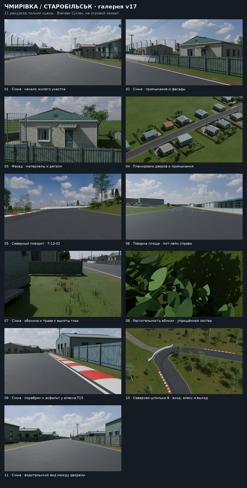

# Трасса Старобільськ — Чмирівка для Assetto Corsa

Проект гоночной трассы по улицам Старобільска и Чмирівки. Сохранённая рабочая версия **v17** представляет собой полную сцену Blender и исходные данные проекта. Это ещё не готовый мод: экспорт KN5, игровой проезд, поведение AI и производительность в Assetto Corsa не проверены.



## Что уже сделано

- Маршрут A → E → B → C → D → A, проектная ширина полотна 8–14 м, поребрики и геометрическая гоночная линия.
- Боксы на правой стороне промзоны после переезда на 4993 м исходной карты; въезд в пит-лейн расположен на 5015 м карты.
- Сохранены картографические контуры зданий и направления боковых улиц, рельеф и придорожное окружение.
- В v17 доработаны фасады 12 домов и выбранные палисадники на участке Сінної; подготовлены 11 новых рендеров и 11 соответствующих изображений v16 для сравнения.

Расположение объектов основано на картографических данных. Внешняя отделка домов и озеленение в основном являются региональной реконструкцией, а не точной фотографической копией каждого адреса. Высоты опираются на Copernicus GLO-30 DSM и не являются дорожной геодезической съёмкой.

## Основные файлы

- [Галерея и сравнения](comparisons/gallery_v17.html) — откройте после скачивания всех файлов репозитория; изображения также доступны в папках `screenshots*`.
- [Текущее состояние](CHMYRIVKA_STATUS_RU.md), [план проекта](CHMYRIVKA_ROADMAP_RU.md) и [визуальный обзор](VISUAL_REVIEW_V17_RU.md).
- [Проверка сцены](VALIDATION_V17_RU.md), [архитектура](ARCHITECTURE_V17_RU.md) и [палисадники](FRONTAGE_V17_RU.md).
- `source_data/`, `data/`, `dependencies/`, `tools/` и скрипты в корне — сохранённые данные, инструменты сборки и проверки.

## Blender-сцена и сборка

Полная сцена `chmyrivka_visual_v17.blend` имеет размер 236 789 965 байт и не включена в обычный Git из-за ограничения на размер файла. Она находится в ранее сохранённом полном архиве `chmyrivka_visual_v17.zip`; его нужно получить у владельца проекта и распаковать. SHA-256 сцены:

```text
06ccd62b4a82cead2a084bd7df0c7879c5f6002d2c9679ff55a9d91fabdafd22
```

Откройте сцену в Blender 4.5.7 или совместимой версии; для просмотра материалов используйте Rendered / Cycles. Инструкция для камеры, рендеров и повторной сборки — в [README_V17_RU.md](README_V17_RU.md). Для повторной сборки v17 дополнительно необходима сцена v16, которая тоже не входит в этот репозиторий. `RELEASE_MANIFEST_V17.json` описывает исходный полный архив, включая большую сцену, поэтому не является списком файлов одного только Git-репозитория.

## Источники и права

Картографические данные: © OpenStreetMap contributors, ODbL. Источники рельефа, материалов и референсов, их лицензии и ограничения приведены в папке [`sources/`](sources/). Частные фотографии не включены в проект. Отдельная лицензия на собственный код проекта владельцем пока не указана; наличие репозитория не назначает её автоматически.
